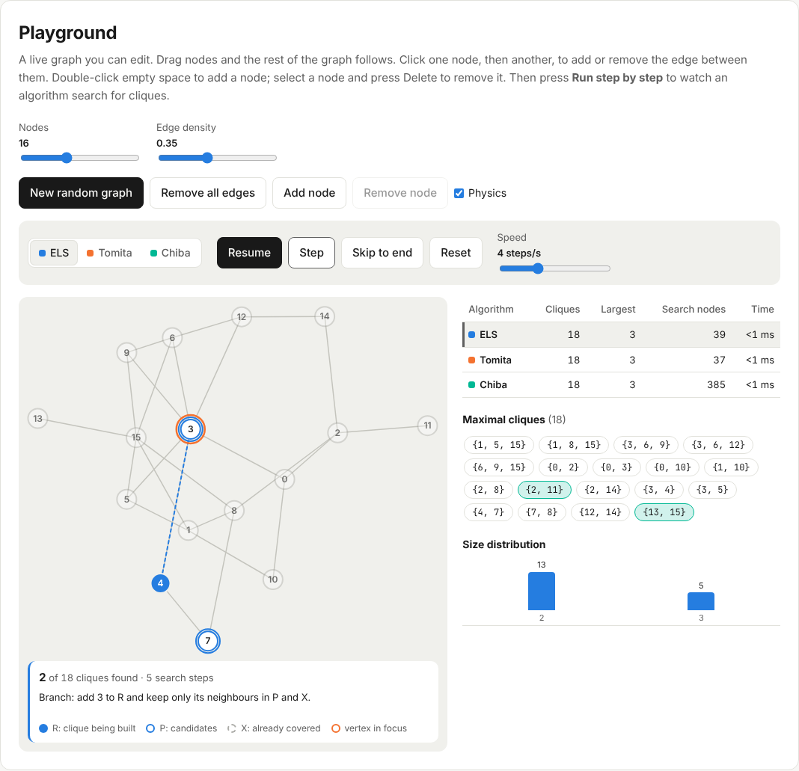

# Maximal Clique Enumeration

Three algorithms for listing every maximal clique in a graph, written in C++ and run on real SNAP networks with up to 1.7M nodes and 11M edges.

**Live demo:** https://rushipatel296.github.io/MaximalCliqueEnumeration/

[](https://rushipatel296.github.io/MaximalCliqueEnumeration/)

## What's inside

| Algorithm | Idea | Source |
|---|---|---|
| **ELS** (Eppstein, Löffler & Strash) | Bron–Kerbosch with pivoting, started from each vertex in degeneracy order | [`src/els.cpp`](src/els.cpp), [`src/els_parallel.cpp`](src/els_parallel.cpp) (OpenMP) |
| **Tomita** (Tomita, Tanaka & Takahashi) | Bron–Kerbosch with the max-neighbour pivot rule, worst-case O(3<sup>n/3</sup>) | [`src/tomita.cpp`](src/tomita.cpp) |
| **Chiba** (after Chiba & Nishizeki) | Degree-ordered include/exclude backtracking with a maximality check at the leaves | [`src/chiba.cpp`](src/chiba.cpp) |

The demo site in [`docs/`](docs) has a live playground that runs JS ports of all three on a graph you can edit: drag nodes (with a force layout), add or remove nodes and edges, and step through each algorithm while it highlights the clique being built, the candidate and excluded sets, and every maximal clique as it is found. It also has the benchmark results.

## Results

| Graph | Nodes | Edges | Maximal cliques | Largest | ELS | Tomita | Chiba |
|---|---:|---:|---:|---:|---:|---:|---:|
| wiki-Vote | 7,115 | 103,689 | 459,002 | 17 | 1.8 s | 3.8 s | 1.2 h |
| email-Enron | 36,692 | 183,831 | 226,859 | 20 | 50.5 s | 13.8 s | 3.3 h |
| as-Skitter | 1,696,415 | 11,095,298 | 37,322,355 | 67 | 13.4 h | 18.0 h | > 18 h |

Sequential times. With OpenMP, ELS drops to 0.46 s, 7.8 s and 56 min.

## Run it

```bash
make
./bin/els data/sample.txt
OMP_NUM_THREADS=8 ./bin/els_parallel data/sample.txt
./bin/tomita data/sample.txt
./bin/chiba data/sample.txt
```

Input is an edge list: first line `n m`, then `m` lines of `u v` with 0-based vertex ids. To use the [SNAP](https://snap.stanford.edu/data/) graphs, drop duplicate edges and renumber vertices to `0..n-1` first.

To preview the site locally: `python3 -m http.server -d docs`.

## Team

Rushi Patel, Khush Bhuta, Daksh Jain, Utkarsh Singhal, Lakshya Maheshwari.
